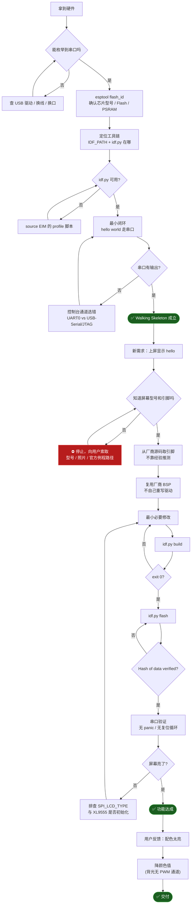
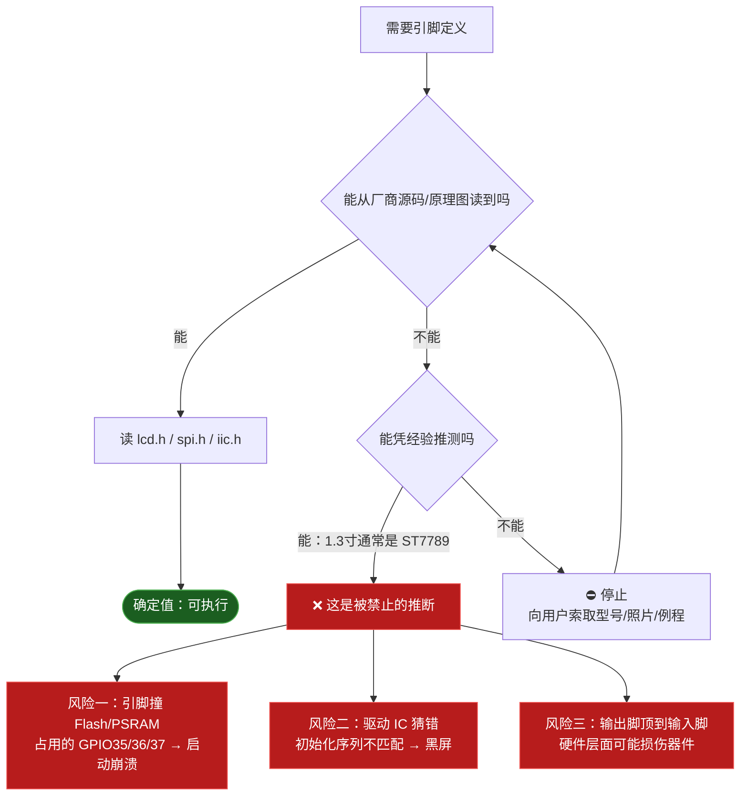
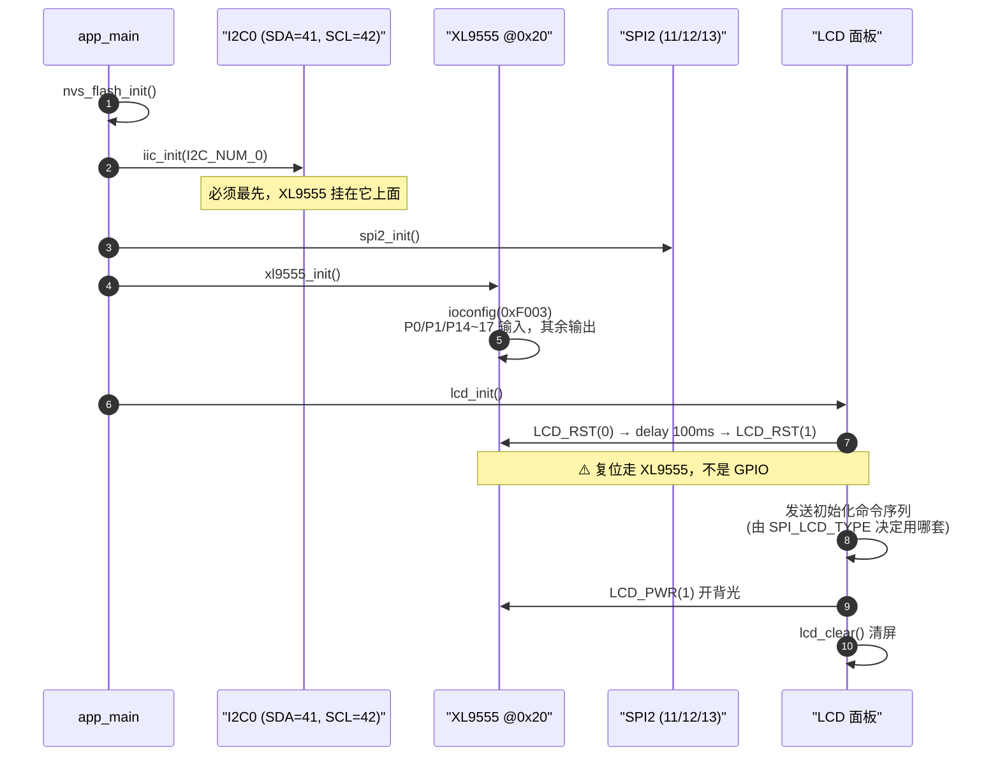
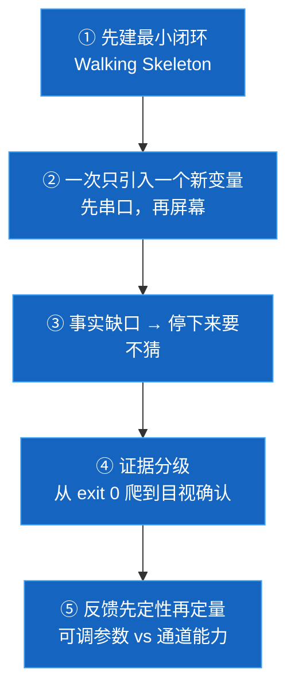

# 从零到一：ESP32-S3 1.3 寸屏 Hello World 全流程

> **本文是什么**：一次真实完成的端到端开发过程的完整复盘（`2026-10-27`）。
> **不是什么**：不是 API 手册，不是最佳实践汇编。文中每个结论都对应一次实测，
> 失败与误判也照实记录——**失败的部分才是可复用的部分**。
>
> 适用读者：要在同一块板（ATK-DNESP32S3 V1）上继续做功能的人，或想把流程搬到别的板子上的人。

---

## 0. 一句话总览

> **先证明"能连上"，再证明"能跑通"，最后才解决"要显示什么"。**
> 每一步都有一个**可证伪的判据**，前一步不过，绝不进入下一步。

这次需求（屏幕显示 hello world）本身很小，但**真正的难点不在写代码**，
而在「不知道屏幕接在哪几个引脚上」——一个**事实缺口**，而不是**能力缺口**。

---

## 1. 全景流程图



**读法**：图中的分叉**全部是"判据不通过"的分支**，而不是"可能出问题"的列举。
每一条反方向箭头，都是这次真实走过或明确规避过的路。

---

## 2. 分阶段详解

### P0 · 建立通信——先确认"它是不是活的"

**目标**：证明电脑能看见这块板。

```powershell
[System.IO.Ports.SerialPort]::GetPortNames()
Get-CimInstance Win32_PnPEntity |
  Where-Object { $_.DeviceID -match 'VID_303A' }
```

| 判据 | 实测 | 含义 |
| --- | --- | --- |
| `VID_303A` | ✅ 命中 | **Espressif 原生 USB**，不是 CH340/CP210x 桥接芯片 |
| `PID_1001` | ✅ | USB-Serial/JTAG（S3 原生） |
| `ConfigManagerErrorCode = 0` | ✅ | 驱动正常，无设备错误 |

**这一步避开的坑**：本机同时存在 `COM3`/`COM4`，但它们是 `BTHENUM\...`（蓝牙虚拟串口）。
只看"有几个 COM 口"会误判。**唯一可靠判据是 VID**。

> **可复用结论**：ESP32-S3 原生 USB 板**不需要装任何 USB 转串口驱动**。
> `工具下载.md` 里列的 CH340/CP210x 驱动，对这块板**一个都用不上**。

---

### P1 · 最小闭环——Walking Skeleton

**目标**：先让"代码 → 编译 → 烧录 → 看到输出"这条路**全程打通**，
此时完全不碰屏幕。屏幕是**第二个变量**，不能和第一个混在一起调。

```c
#define HELLO_PERIOD_MS 1000
void app_main(void) {
    TickType_t last_wake = xTaskGetTickCount();
    while (1) {
        printf("Hello world!  uptime=%lld ms\n", esp_timer_get_time()/1000);
        vTaskDelayUntil(&last_wake, pdMS_TO_TICKS(HELLO_PERIOD_MS));
    }
}
```

**这里有一个必须改的配置**：

```ini
CONFIG_ESP_CONSOLE_USB_SERIAL_JTAG=y
```

IDF 默认控制台是 **UART0**。这块板的 UART0 没有接到 USB 上，
不改这一项，**烧录会成功，但 COM5 一个字都不会有**——
这是最容易被误判成"烧录失败"的形态。

**验证用双时钟互证**（这是我这次刻意做的）：

| 时钟 | 读数 |
| --- | --- |
| 设备自报 `uptime`（`esp_timer`） | 9007 → 10007 → 11007 … 严格 +1000 |
| 宿主侧 `Stopwatch` 打点 | 1062 → 2062 → 3062 … 严格 +1000 |

> **为什么值得这么做**：只用宿主时钟，"1 秒一行"可能是巧合；
> 两个**互不相关的时钟**都给出 1000 ms，才能排除观测误差。

**本阶段产出**：一个**能跑的东西**。按本框架 `AGENTS.md` §0.2，它从此成为
**不可协商的回归基线**——后续任何改动都不得把它拆掉。

---

### P2 · 需求变了——从"串口"到"屏幕"

新需求：**在 1.3 寸屏上显示 hello world**。

这一步**看起来是加功能，实际是先遇到一个事实缺口**：

> 只知道模组型号 `ATK-MWS3S N16R8`，**不知道开发板型号**，更不知道屏幕接在哪几个脚上。

#### 为什么不能猜



**判断的关键区分**：

| 层级 | 是什么 | 谁决定 |
| --- | --- | --- |
| 芯片 | ESP32-S3 | 乐鑫 |
| 模组 | ATK-MWS3S N16R8 | 正点原子 |
| **开发板** | **ATK-DNESP32S3 V1** | **正点原子（这块板的引脚表）** |

> 「ESP32-S3 是开发板型号吗？」——**不是**。它是芯片名。
> 同一颗 ESP32-S3，正点原子接 `GPIO21/40`，微雪接 `GPIO10/11/12`，斑梨接 `GPIO38/39`。
> **板子型号就是那张接线表的名字。**

#### 事实是怎么拿到的

不是靠搜索引擎的二手文章，而是**从用户机器上的官方资料里读源码**：

```
C:\Users\Yotoha\Desktop\【正点原子】DNESP32S3开发板\...（A盘）\4，程序源码\
  v5.1.2版本的例程\1，标准例程-IDF版\basic_routines\12_spilcd\
      components\BSP\{LCD,SPI,IIC,XL9555}\
```

读出来的（**全部带文件行号，可复核**）：

| 信号 | GPIO | 出处 |
| --- | --- | --- |
| SPI2_SCLK | GPIO12 | `SPI/spi.h:32` |
| SPI2_MOSI | GPIO11 | `SPI/spi.h:31` |
| SPI2_MISO | GPIO13 | `SPI/spi.h:33` |
| LCD_DC (WR) | GPIO40 | `LCD/lcd.h:37` |
| LCD_CS | GPIO21 | `LCD/lcd.h:38` |
| I2C0_SDA | GPIO41 | `IIC/iic.h:51` |
| I2C0_SCL | GPIO42 | `IIC/iic.h:52` |

**最关键的发现**：屏幕的 **RST 和背光压根不接 GPIO**，而是走 **XL9555 I/O 扩展芯片**：

| 功能 | 位掩码 | 出处 |
| --- | --- | --- |
| `SLCD_RST_IO` | `0x0400` | `XL9555/xl9555.h:59` |
| `SLCD_PWR_IO`（背光） | `0x0800` | `XL9555/xl9555.h:60` |

> 这一条如果没查到，写出来的代码会**编译通过、烧录成功、屏幕全黑**——
> 现象和"驱动写错"完全一样，将浪费大量时间在错误的方向上排查。

---

### P3 · 复用，而不是重写

**决策**：把厂商 `components/BSP` 整目录复制进工程，**不自己写驱动**。

理由（对应本框架 §0.2）：

1. 厂商 BSP 已在该硬件上验证过；
2. 自写驱动要重新调初始化序列、时序、扫描方向，**产出不确定**；
3. 「能跑的东西不得在没有架构指令时重写」。

```powershell
Copy-Item 官方12_spilcd\components\BSP  ->  工程\components\BSP -Recurse
```

复制过来的内容：`IIC` / `LCD`（含 73 KB 字库）/ `LED` / `SPI` / `XL9555`。

---

### P4 · 最小必要修改——只改两处

厂商代码默认按 **2.4 寸屏**配置，本板是 **1.3 寸**。两处必改：

| 位置 | 原值 | 改为 | 改错会怎样 |
| --- | --- | --- | --- |
| `lcd.c:29` `SPI_LCD_TYPE` | `1`（2.4寸） | `0`（1.3寸） | **两套初始化序列完全不同** → 黑屏 |
| `lcd.c` `lcd_display_dir()` | 写死 240×320 / 320×240 | 1.3寸固定 **240×240** | 窗口越界 + 清屏只刷一半，**下半屏不更新** |

两处均以 `/* ===== 本地修改（本项目） ===== */` 标注，方便日后与上游比对。

**为什么第二处必须改**：`lcd_clear()` 依赖 `LCD_TOTAL_BUF_SIZE (320*240*2)` 分块发送，
而 240×240 只有它的一半，不改会导致**下半屏残留旧内容**。

---

### P5 · 初始化顺序——这里有一个硬依赖



**顺序不可颠倒**：

- `I2C` 必须早于 `XL9555`（它就是挂在 I2C 上的从设备）
- `XL9555` 必须早于 `LCD`（屏幕的复位和背光都由它控制）

> **只初始化 SPI 不初始化 XL9555 = 屏幕既不复位也没有背光 = 全黑无反应。**

---

### P6 · 验证阶梯——从弱证据到强证据

这是本文最想强调的一节。**"没报错"和"功能对"是两件事**，
要把证据按强度分级，逐级往上爬。


**第 ④ 级的间接判据值得单独说明**：

`xl9555_ioconfig()` 失败时的代码是（`xl9555.c:139-155`）：

```c
retry--;
if ((retry <= 0) && xl9555_failed) {
    vTaskDelay(5000);
    esp_restart();          // ← 重试 3 次仍失败 → 主动重启
}
```

**这意味着**：只要程序**连续运行超过 15 秒没有重启**，
就说明 **I2C 通信成功、XL9555 应答正常、屏幕复位与背光控制通路成立**。

> 这是一个**不需要看屏幕**就能拿到的强证据。
> 在无法目视的场景（远程设备、屏幕在背面）下，这类判据尤其有价值。

**第 ⑥ 级只有人能给**：我看不到屏幕，必须由用户确认。
在拿到这句确认之前，我能说的上限是「代码跑到了、通路成立了」。

---

### P7 · 反馈迭代——"太亮"其实是个硬件问题

用户反馈：**配色太亮**。

**第一反应不该是调参数，而是先查"有没有得调"**：

```powershell
# 在 BSP 全目录搜索
Grep -pattern 'ledc|PWM|LCD_BL' components/BSP
```

结果：**没有任何 `ledc` 调用**。背光走 `SLCD_PWR_IO`（XL9555 的数字 IO），
**只有开和关两档，没有 PWM 通道**。

**结论**：亮度**无法软件调节**，只能压低颜色值本身。

| 用途 | 改前 | 改后 | 依据 |
| --- | --- | --- | --- |
| 背景 | `0x0000` 纯黑 | `0x1082` RGB(16,16,16) | 减少纯黑反差 |
| 标题 | `0x07FF` 满亮度青 | `0x3AD1` RGB(57,89,140) | 降 45% |
| 正文 | `0xFFFF` **纯白** | `0x94B2` RGB(148,150,148) | 降 41% |
| 强调 | `0xF800` **满亮度红** | `0x9365` RGB(148,109,41) | 降 42% |

**刺眼的元凶是纯白和满亮度红**——这两个在 1.3 寸小屏上对比度过高。

> **可复用判断**：遇到"太亮/太暗"这类反馈，先分清是
> **可调参数问题**（→ 调参数）还是**通道能力问题**（→ 只能换实现方式）。
> 本板属于后者，硬调亮度需要改硬件。

---

## 3. 硬件拓扑图

```mermaid
graph LR
    subgraph S3["ESP32-S3 · ATK-MWS3S N16R8"]
        SPI2["SPI2<br/>SCLK=12 · MOSI=11 · MISO=13"]
        I2C0["I2C0<br/>SDA=41 · SCL=42"]
        G40["GPIO40<br/>= DC"]
        G21["GPIO21<br/>= CS"]
    end

    subgraph PANEL["ATK-MD0130 · 1.3\" 240×240"]
        P_SPI["SPI 接口"]
        P_RST["RST"]
        P_BL["背光 (BL)"]
    end

    XL["XL9555<br/>I/O 扩展 @0x20"]

    SPI2 -->|"cmd/data"| P_SPI
    G40 -->|"DC 选通"| P_SPI
    G21 -->|"片选"| P_SPI
    I2C0 <-->|"400 kHz"| XL
    XL -->|"SLCD_RST_IO = 0x0400"| P_RST
    XL -->|"SLCD_PWR_IO = 0x0800"| P_BL

    classDef warn fill:#b71c1c,stroke:#ef5350,color:#fff
    class XL warn
```

> 图中 **XL9555 标红**是刻意的：它是这条链路上**唯一不直观的一环**。
> 少了它，SPI 波形再正确，屏幕也不会亮。

**另一个坑（已实测确认无害）**：`GPIO40` 被两份代码定义为不同用途——
`lcd.h` 说是 `LCD_NUM_WR`（DC），`xl9555.h` 说是 `XL9555_INT_IO`。
启动日志显示**先配为输入、后配为输出**，最终生效的是 LCD 用途。
实际硬件上 XL9555 的中断并未接到这个脚（或是复用后中断不可用），所以不冲突。
**但这属于厂商代码的命名隐患，记录在此以免日后误解。**

---

## 4. 这次踩过的四个坑（含我自己的判断失误）

| # | 坑 | 表现 | 根因 | 教训 |
| --- | --- | --- | --- | --- |
| 1 | **判 IDF 未安装** | 报"工具链不存在" | 只查了 `C:\esp` 和环境变量 `IDF_PATH`，实际装在 `D:\IDF-tools`，且 `IDF_PATH` 只在 source profile 后才存在 | **查"不存在"必须先穷尽候选路径**，否则"没找到"被误读成"没有" |
| 2 | **给了未验证的命令** | 让用户跑 `idf.py monitor`，自己没先跑过 | 我只验证了直接读串口，跳过了这条 | **给别人命令前，自己必须先跑通一次** |
| 3 | **错误归因** | 猜"没反应"是 DTR/RTS 把芯片拖进下载模式 | 没有先做对照实验就下结论 | **做了对照实验才推翻它**：`DTR/RTS = 0/0` 与 `1/1` 都有输出，S3 原生 USB 不理这两个信号 |
| 4 | **覆盖了出厂固件** | 第一次烧 hello world 时，把 `0x10000` 的 factory 分区覆盖了 | 没意识到"出厂固件里可能藏着这条屏幕的引脚配置" | **烧录前先想想：现有固件里有没有我需要的线索？** 这条线索一旦覆盖就没了 |

> **第 3 条的方法论**：当"没反应"时，先找**能区分的证据**，再猜原因。
> 这次的区分证据是：**当时 COM5 能成功打开** ⇒ 说明没有任何终端在读它
> （`idf.py monitor` 会独占端口，实测占用时 `Open` 报 `Access denied`）
> ⇒ 「没反应」是**观测问题**，不是固件问题。

---

## 5. 可复用的方法论（五条）



### ① 先建最小闭环
在碰第二个硬件之前，先让"编译→烧录→看到输出"整条路打通。
**屏幕是第二个变量，不能和第一个混在一起调。**

### ② 一次只引入一个新变量
先串口（已知能通）→ 再屏幕（未知）。混在一起调，出问题时无法定位是哪一环。

### ③ 事实缺口就停下来要
「不知道引脚」和「不会写驱动」是**两类完全不同的问题**。
前者**必须索取**，后者可以自己解决。把前者当成后者硬猜，代价是黑屏甚至硬件损伤。

### ④ 证据分级
`exit 0` ≠ 功能正确。要能说清楚**当前证据支持到哪一级**，
以及**下一级需要什么**（本案例的第 ⑥ 级只能由人提供）。

### ⑤ 反馈先定性再定量
"太亮" → 先查**有没有得调**（有无 PWM），再谈调多少。
通道能力不足时，调参数是在错误的方向上努力。

---

## 6. 本案例的最终产物清单

| 文件 | 作用 |
| --- | --- |
| `main/main.c` | 显示逻辑 + 配色（四个颜色宏在顶部） |
| `components/BSP/` | 厂商 BSP，**2 处本地修改已标注** |
| `sdkconfig.defaults` | 控制台走 USB-JTAG；Flash 16MB |
| `docs/changes/001-*.md` | 串口版 hello world（已被 002 取代，留作基线） |
| `docs/changes/002-*.md` | 本次：屏幕显示，含全部实测日志 |
| `docs/ledger.md` | `GAP-001..007` / `DEFER-001..003` |

**遗留缺口**（详见台账）：

| 编号 | 内容 | 性质 |
| --- | --- | --- |
| `GAP-004` | 01 设计环无 ADR 与可测验收标准 | **阻塞后续业务开发** |
| `GAP-005` | 背光无法软件调光 | 硬件限制，不修 |
| `GAP-006` | 使用 IDF 已弃用的旧版 I2C 驱动 | 未来升级需迁移 |
| `GAP-007` | BSP 为厂商代码副本，无同步机制 | 升级时需人工 diff |

---

## 附 · 复现命令

```powershell
# 1. 激活环境（每次新开终端都要）
. 'C:\Espressif\tools\Microsoft.v5.4.4.PowerShell_profile.ps1'

# 2. 进工程
cd D:\MyDocuments\esp32_env\ai-collaboration-framework\esp32s3-project

# 3. 编译 → 烧录 → 监视
idf.py build
idf.py -p COM5 flash
idf.py -p COM5 monitor        # Ctrl+] 退出

# 换屏幕尺寸后必须彻底清理
idf.py fullclean && idf.py build
```

**判定成功的依据（按强度递增）**：

1. `build` 输出 `Project build complete`，`exit 0`
2. `flash` 输出三笔 `Hash of data verified`
3. `monitor` 出现 `=== ESP32-S3 1.3" LCD Hello World ===` 且**无 panic、无复位循环**
4. 连续运行 > 15 秒不重启（证明 XL9555 未触发 `esp_restart`）
5. **屏幕上出现文字**（唯一无法替代的判据）
